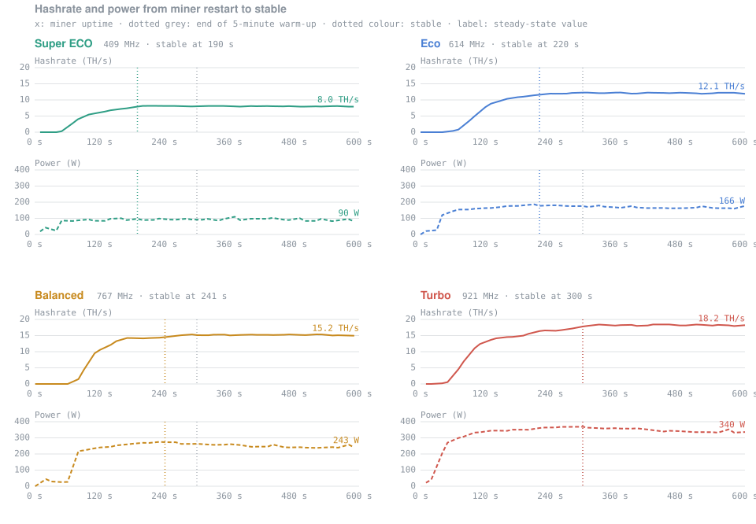

# Development

Notes for working on the integration. For using it, see [README.md](README.md).

## Repository layout

| Path | Purpose |
|---|---|
| `custom_components/apollo_iii/` | The integration (domain `apollo_iii`). This folder is what users install. |
| `custom_components/apollo_iii/translations/en.json` | UI strings and entity names. Custom integrations load these, not `strings.json`; keep the two identical. |
| `custom_components/apollo_iii/icons.json` | Entity icons, by translation key. |
| `tests/` | pytest suite; `tests/fixtures/` holds sanitized responses captured from a real miner. |
| `.github/workflows/` | CI: hassfest and HACS validation, and the test suite. |
| `custom_components/apollo_iii/brand/` | Local brand images (Home Assistant 2026.3+). |
| `hacs.json` | HACS metadata. |
| `deploy.sh` | Copies the integration into a local Home Assistant config for testing. |

## How it works

### Data sources
The miner runs FutureBit's Apollo Web OS (tested with v2.1.3), whose backend is ([apolloapi-v2](https://github.com/jstefanop/apolloapi-v2), `staging` branch for Apollo III; the UI is [apolloui-v2](https://github.com/jstefanop/apolloui-v2)). The integration talks to its GraphQL API at `http://<host>:5000/api/graphql`.

| Coordinator | Interval | Query | Auth |
|---|---|---|---|
| `miner` | 15 s | `Miner.online`, `Miner.stats` | none |
| `mcu` | 30 s | `Mcu.stats` (controller) | token |
| `settings` | 60 s | `Settings.read`, `Services.stats` | token |
| `logs` | 30 s | `Logs.read` (MINER) | token |

Login is `Auth.login(password)`, which returns a JWT. A wrong password is a GraphQL error with code `UNAUTHENTICATED` (`ApolloAuthError`), which starts Home Assistant's reauth flow. GraphQL introspection is disabled on the miner; use the typeDefs in apolloapi-v2.

### Miner quirks the code depends on
- **The MINER log is a screen snapshot,** not a file: `screen -X hardcopy` of the miner's terminal, about 25 lines, hard-wrapped at 80 columns. `logparse.py` joins wrapped lines. It scrolls in seconds, so the fault monitor uses the stats, not the log, as its main signal.
- **DVFS log lines** (every ~3 s) are the only source of the active hashrate target, board voltage setpoint, fan PWM and tuner phase. The phase label stays at `TUNE_STEPPING_UP` indefinitely in Super ECO, so `Tuning state` reports observed changes instead.
- **Slot-level `errors` / `errorRate` are always 0** on the Apollo III. Chip errors are in `master.intervals.int_*`.
- **Hashrate fields:** the `Hashrate` sensor reads `slots.int_0.ghs`; the fault monitor and the debug log use `master.intervals.int_30.bySol` (falling back to `ghs`). The two carry the same value. The 1 h average is `int_3600.bySol`. In `master.intervals`, `int_0` covers the whole miner run.
- **Settings apply only at miner start.** `Settings.update` rewrites the config file; the miner reads it once. `configurator.js` uses `minerHashrate` only in `custom` mode, spells Super ECO `supereco` on the command line, treats 0 or null fan values as unset, and lets a fixed PWM override the temperature target. `restart_needed.py` mirrors that logic.
- **No RTC on the controller:** after a reboot, NTP jumps the clock forward and `master.upTime` includes the jump.
- **Stats staleness:** `stats.date` updates about every 10 s; the dashboard treats more than 1 minute as inactive.
- **Chip frequency:** `master.osc` is the chip clock in MHz, fixed per power mode (see [Measured power modes](#measured-power-modes)); `int_30.chipSpeed` / `osc` stays about 930–945 hashes per clock. FutureBit's code calls the same value `frequency` and shows it in MHz on the older Apollos.
- **Hostname** is `futurebit-apollo-3` on every unit, so entries are keyed by the controller MAC (`Mcu.stats.network[eth0].mac`).

### Measured power modes
Measured on 2026-11-16 on one Apollo III Standard (21 chips, Web OS v2.1.3) at one room temperature. Each preset was started from Home Assistant with a miner restart and sampled every 15 s from the API; steady state is the mean of about 3 minutes of samples after the start-up errors cleared. Board voltage, fan PWM and the hashrate target come from the DVFS log.

| Mode | Chip freq | Hashrate | Power | Efficiency | Max chip temp | Board voltage | Fan PWM | Stable at | Peak temp | Peak power |
|---|---|---|---|---|---|---|---|---|---|---|
| Super ECO | 409 MHz | 8.01 TH/s | 91 W | 11.3 J/TH | 56 °C | 5.37 V | 14 % | 190 s | 60 °C | 110 W |
| Eco | 614 MHz | 12.11 TH/s | 166 W | 13.7 J/TH | 65 °C | 6.11 V | 28 % | 220 s | 71 °C | 187 W |
| Balanced | 767 MHz | 15.19 TH/s | 243 W | 16.0 J/TH | 73 °C | 6.64 V | 47 % | 241 s | 82 °C | 275 W |
| Turbo | 921 MHz | 18.23 TH/s | 340 W | 18.6 J/TH | 81 °C | 7.12 V | 100 % | 300 s | 90 °C | 369 W |

- "Stable at" is miner uptime after which every sample stayed within 5 % of the steady hashrate with the 30-second chip error rate under 5 %. Peak values cover the run from restart to the end of sampling.
- Every start has a burst of chip errors (peaks of 66–93 %). The 30-second rate falls under 5 % within 171–280 s, but the 5-minute rate keeps the burst until 370–420 s. That is why the `high_error_rate` check waits out the startup grace and also requires the 30-second rate.
- The tuner phase read `TUNE_STEPPING_UP` and the DVFS state `NORMAL` in every mode.
- Turbo runs the fan at 100 % PWM, so it has no cooling headroom.



### Modules
| File | Role |
|---|---|
| `__init__.py` | Setup, unique-ID migration, title sync. |
| `const.py` | Poll intervals, fault thresholds and other constants. |
| `coordinator.py` | Coordinators, stats/log staleness, `ApolloData` (`entry.runtime_data`). |
| `api.py` | GraphQL client and queries. |
| `diagnostics.py` | Diagnostics download, with credentials, MACs, addresses and the pool user redacted. |
| `config_flow.py` | User, DHCP, reconfigure and reauth steps. |
| `logparse.py` | Screen-snapshot parsing and DVFS values. |
| `general_errors.py` | Fault monitor: stats conditions, events, log matching, incident counter. |
| `restart_needed.py` | Tracks the settings the running miner loaded. |
| `entity.py` | Base entity: unique IDs, translation keys, device info. |
| `sensor.py`, `binary_sensor.py`, `select.py`, `number.py`, `switch.py`, `button.py` | Entity platforms. |

## Local development

Installs normally come from HACS (GitHub releases). For testing a change before releasing it, `deploy.sh` copies `custom_components/apollo_iii` into a Home Assistant config folder, backing up the existing copy first. It does not restart Home Assistant; Python changes load only after a restart.

```sh
./deploy.sh                                            # defaults below
HA_CONFIG=/path/to/config BACKUP_DIR=/path/to/backups ./deploy.sh
```

| Variable | Default |
|---|---|
| `HA_CONFIG` | `/config` |
| `BACKUP_DIR` | `$HOME/apollo-iii-backups` |

Then check the configuration and restart Home Assistant (`ha core check` and `ha core restart` on Home Assistant OS).

On an install managed by HACS, a deployed test build replaces the HACS-installed files until the next HACS update; after releasing, update through HACS so it tracks the released version again.

### Entity names and translations
Entities have no hardcoded names: each sets a translation key (its unique-ID key, lowercased) and the name lives in `translations/en.json` under `entity.<platform>.<key>.name`. Select options and the tuning state are translated state keys. Add new entities to both translation files and, if they need an icon, to `icons.json`.

## Testing

The suite uses [pytest-homeassistant-custom-component](https://github.com/MatthewFlamm/pytest-homeassistant-custom-component), pinned in `requirements_test.txt` to the Home Assistant version it targets. That version needs **Python 3.14.2 or newer**; with an older Python, `pip` cannot find the pinned package.

```sh
python3.14 -m venv .venv && . .venv/bin/activate
pip install -r requirements_test.txt
pytest
```

`tests/conftest.py` provides `FakeMiner`, which answers the integration's GraphQL queries from `tests/fixtures/` and records settings updates and miner commands. Use it to simulate a wrong password (`fake_miner.password`), an unreachable miner (`fake_miner.unreachable`), or changed stats. To refresh the fixtures from a real miner, capture the four queries and replace every MAC, IP address and pool username before committing.

CI runs the tests, hassfest and the HACS validator on every push and pull request; the validators also run weekly (Mondays, 06:00 UTC).

## Releasing

1. Update `version` in `custom_components/apollo_iii/manifest.json` and add an entry to `CHANGELOG.md`.
2. Make sure CI is green.
3. Tag and publish a GitHub release named `vX.Y.Z` with the changelog entry as notes. HACS installs from releases.
